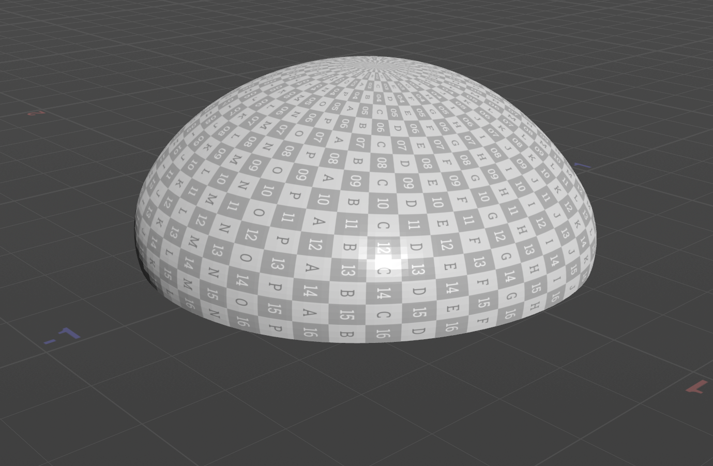
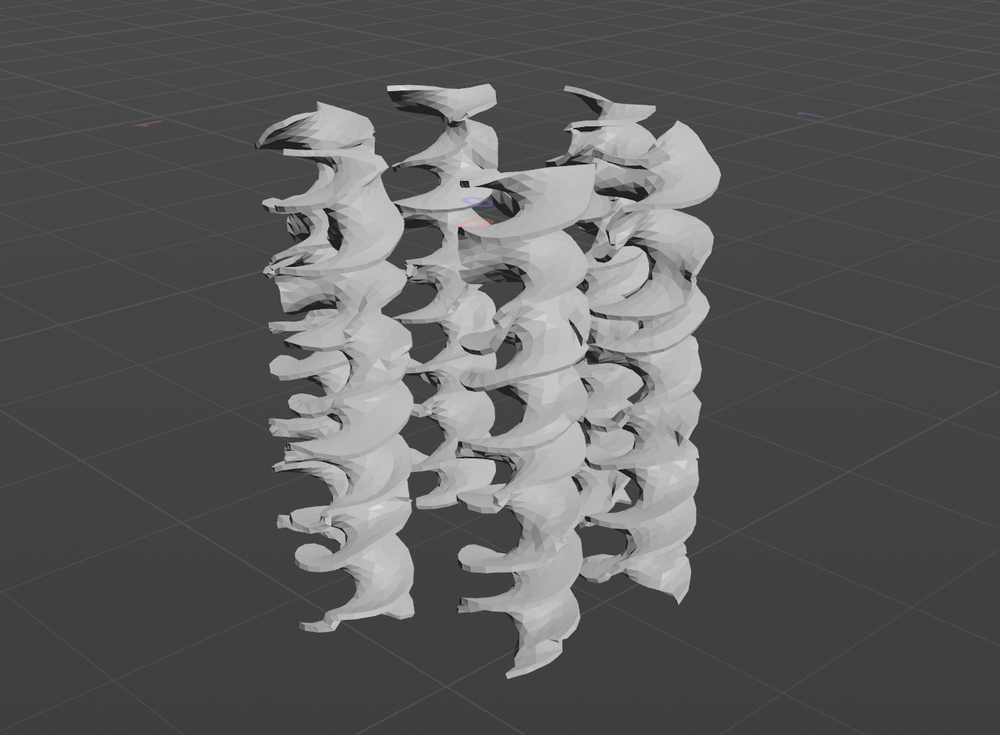
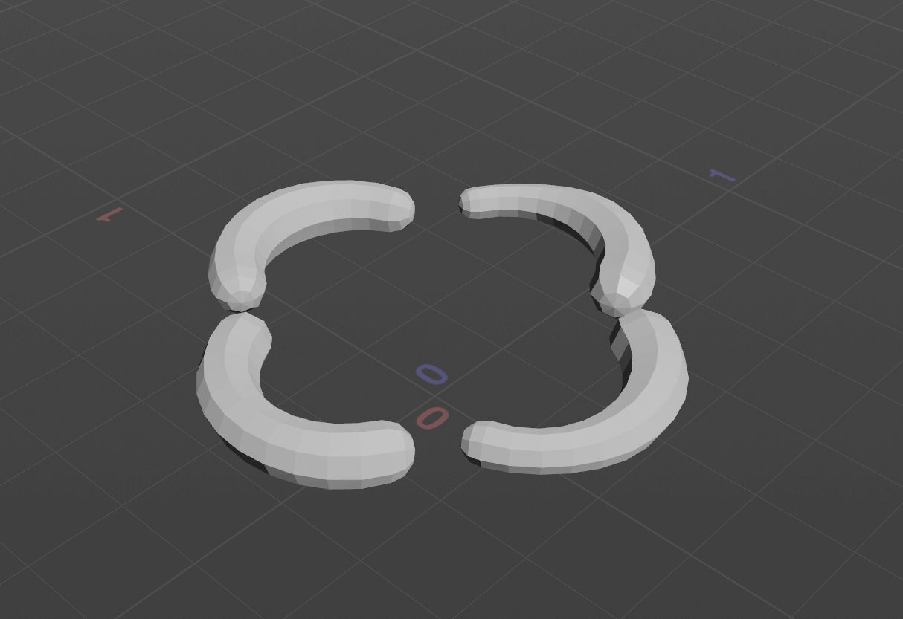
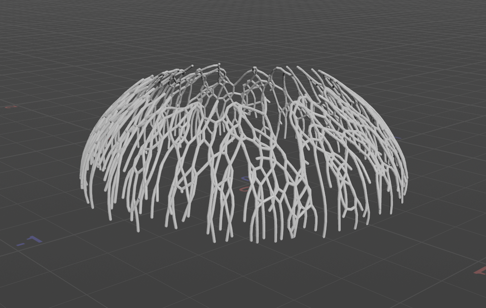
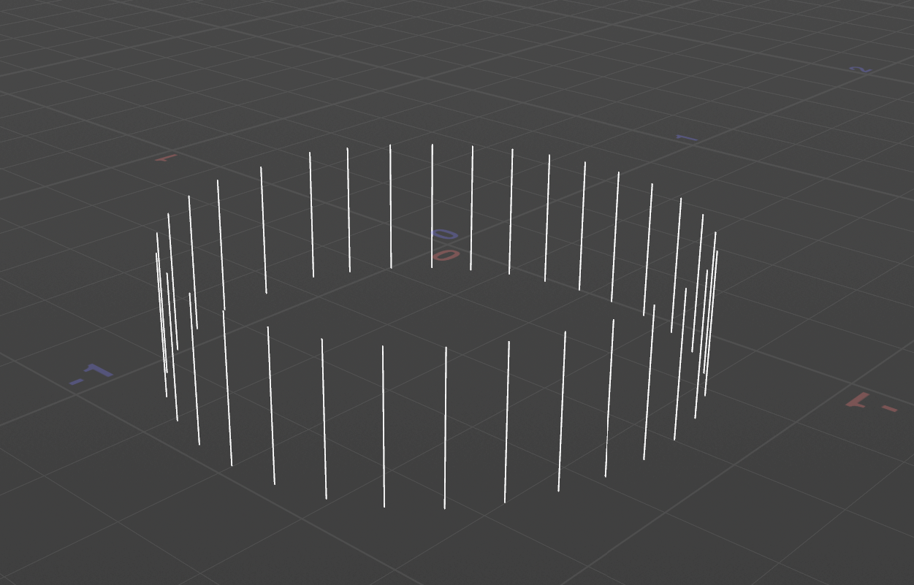

Charlie Wang
HW 03 Houdini Jellyfish

Created a jellyfish in Houdini.

<video width="640" controls>
  <source src="./charliejellyfishvid.mp4" type="video/mp4">
</video>

# Element Breakdown

## Bell

## Arms

## Organs
  
I created organs by bending a line and then sweeping it, before adding mountain noise.

## Veins
  
I selected a sample of the topmost and bottommost points on the bell and then found the shortest path from any start to each end. Then I fused, resampled, and smooth the paths. Then I used sweep to add volume.

## Tentacles
  
I selected the bottom ring of points on the bell mesh and added line hairs to each point before adding vellum hair sim shown in the video.
