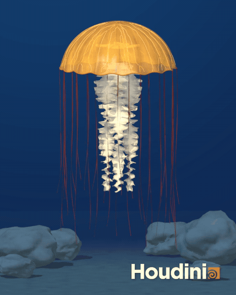
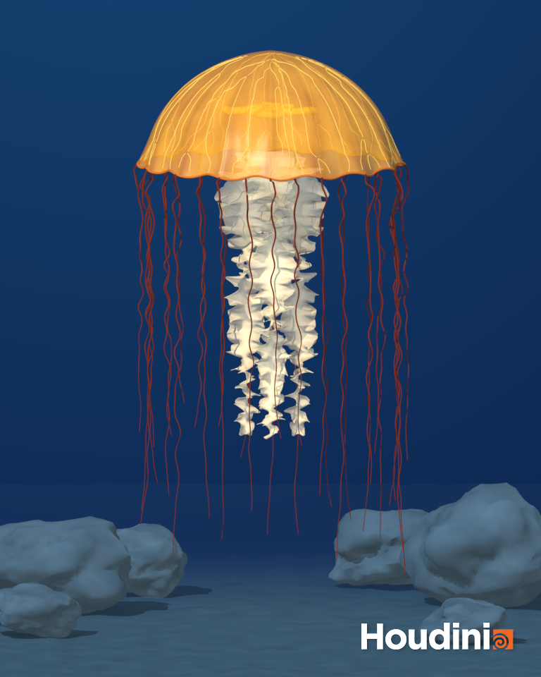

# Procedural Sea Nettle

**Yao Tang**

This project is inspired by the Pacific sea nettle. The jellyfish has a golden bell, four cream-colored oral arms, four internal organs, and 32 reddish-brown tentacles. It floats above a seabed with six rocks. The bell contracts and expands, while the arms and tentacles move with the water.

## Results

[Animation video](media/jellyfish-animation.mp4)

[Close-up view](media/jellyfish-detail.png)

The animation is six seconds long and was rendered with Mantra in Houdini Apprentice 22.0.466.

## Modeling and animation

**Bell.** The bell starts from a line shaped with two Bend nodes, following the tutorial. Revolve creates the surface, and Poly Extrude gives it a thin shell. The bend angles change over time to create the pulsing motion. The surface has a scalloped edge, shallow ribs, and golden radial markings.

**Oral arms.** A grid is tapered, twisted, and folded along its edges, then copied into four arms. Point Deform follows the movement of the bell's center. Vellum Cloth simulates the arms, with their upper points pinned to the moving targets. The thin edges are more transparent than the centers.

**Veins.** The bell is remeshed into triangles. Find Shortest Path generates 48 paths, which are joined and smoothed with Fuse, Resample, and Smooth. Sweep adds thickness, and Point Deform keeps the veins attached to the animated bell.

**Organs.** Four horseshoe-shaped curves are placed inside the bell. Sweep gives them thickness, and Point Deform makes them follow the bell. They can be seen through the transparent surface.

**Tentacles.** There are 32 curves around the bell rim, with different lengths. Vellum Hair keeps their roots attached to the bell and lets the tips move freely. A mild POP Force adds water movement. The curves are smoothed and given thickness after simulation.

## Extra credit

- **Refining the model:** scalloped edges, shallow ribs, radial color variation, and detailed oral-arm folds.
- **Rendering:** translucent materials, lighting, still images, and a six-second rendered animation.
- **Background:** six rocks with different shapes and sizes, a rippled seabed, and blue lighting. The seabed fades into the water in the distance.

## Project controls

The main controls are on `/obj/jellyfish/jellyfish_generator`. They change the bell size and pulse, arm and tentacle counts and sizes, vein count, and water current. `Bell Opacity` and `Oral Arm Opacity` adjust transparency without restarting the simulation.

Open `hw03_jellyfish.hipnc` in Houdini and play frames 37–180. Frames 1–36 allow the simulation to settle. Start from frame 1 after changing the shape or simulation settings. Keep the `cache` folder beside the HIP file to use the saved simulation.

The five parts can be viewed separately through `OUT_BELL`, `OUT_ARMS`, `OUT_VEINS`, `OUT_ORGANS`, and `OUT_TENTACLES`. The rocks and seabed are in `/obj/seafloor_environment`.

The Houdini project is kept separately from the GitHub repository, following the assignment instructions. Build and rendering scripts are included in the GitHub repository.

## References

- Visual reference: Pacific sea nettle (*Chrysaora fuscescens*) photograph.
- [Elyssa Choudini — Jellyfish Part 1: Bell](https://www.youtube.com/watch?v=J3X8BB0yNRE)
- [Elyssa Choudini — Jellyfish Part 2: Arms](https://www.youtube.com/watch?v=A_oNXqx8XH4)
- [Nick Medukha — Vellum Hair Organic Wireframe](https://www.youtube.com/watch?v=LN4XXaHQkmU)
- [SideFX — Find Shortest Path](https://www.sidefx.com/docs/houdini/nodes/sop/findshortestpath.html)
